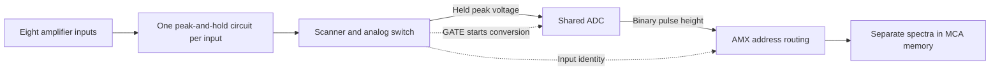

# ND 588 Analog Multiplexer

The Nuclear Data ND588 AMX is an eight-input NIM analog multiplexer for
sharing a spectroscopy analog-to-digital converter (ADC) among several
detector channels. The research points to an event-driven acquisition
system: each input captures a pulse height, the AMX presents stored heights
to the ADC in turn, and detector-identification bits route the converted
results into separate spectra in the multichannel analyzer (MCA).

This operating model is supported by the
[shared research conversation](https://chatgpt.com/share/6ad5298c-4cbc-83e8-92c9-102fc26aa6bf),
the
[component-side board photograph](images/Nuclear%20Data%20ND588%20AMX%20pcb%20component.jpg),
and comparison with the Canberra 8224 AMX. The
[8224 user's manual](https://nuclearphysicslab.com/npl/wp-content/uploads/Canberra_8224_AMX_Analog_Multiplexer.pdf)
documents the architecture in detail; a
[local copy](docs/Canberra_8224_AMX_Analog_Multiplexer.pdf) is available
here. An ND588 manufacturer's manual or schematic was not located in the
research. The Canberra manual is a strong functional reference, but
electrical interchangeability with the ND588 has not been established.

## How it works

The important distinction is that input selection happens automatically as
events arrive. An external controller does not need to choose one detector
and leave it connected. There is still an analog switching network inside
the AMX, but it switches among captured pulse heights under scanner
control.

The following sequence is documented for the Canberra 8224 and is the
likely operating sequence of the ND588:

1. **Capture a pulse.** A shaped spectroscopy-amplifier pulse exceeds the
   lower-level discriminator (LLD) threshold. That input's
   peak-detect-and-hold circuit tracks the rising pulse and stores its
   maximum voltage on a capacitor.
2. **Hold the event.** Once the peak is detected, the channel signals that
   it is ready and inhibits further charging of its storage capacitor until
   the event has been serviced.
3. **Select a ready input.** The scanner examines the channels in turn.
   When it finds a stored event, it stops and connects that channel's held
   voltage to the common analog output feeding the ADC.
4. **Start conversion.** The AMX generates a `GATE` pulse to the ADC,
   causing it to convert the selected voltage.
5. **Route the result.** The ADC supplies the binary pulse-height result.
   The AMX combines it with routing bits identifying the input, then
   presents the resulting histogram address to the MCA.
6. **Reset and continue.** After the MCA accepts the result, the serviced
   peak-hold circuit is reset and scanning resumes from where it stopped.

This diagram shows the functional signal path; it is not a wiring diagram.
The analog output is a succession of selected stored voltage levels
presented for conversion, rather than a sum of the original detector
waveforms. Detector identity is preserved digitally through the
address-routing logic.

Independent peak storage explains how events on different inputs can be
retained while one ADC services them sequentially. It does not provide an
unlimited event queue: in the 8224, a channel already holding a peak cannot
capture another event until it is reset. Simultaneous events on different
inputs need not immediately discard one another, but dead time and
count-rate limits still apply. The 8224 specifies equal input priority
through scanning; the ND588's exact scan rate and arbitration timing remain
unverified. See the 8224 manual, Introduction and Circuit Description,
printed pages 1 and 10-12.

## GATE and TRIGGER

**The best-supported interpretation is that the ND588 `GATE` connector is
an output to the downstream ADC.** In the 8224, this is explicit: `GATE`
starts conversion after the selected peak voltage is presented at the
analog output. Its specification is a negative-going TTL pulse
approximately 1 microsecond wide. That polarity, voltage level and width
are 8224 specifications, not verified ND588 specifications.

The ND588 board examined in the research has separate `GATE` and `HOLD`
markings, as well as `ADC`, `MCA` and `EXP.` interfaces. These observations
support the same sequence of capturing a peak, holding it, and then
requesting ADC conversion. The initial suggestion in the research that
`GATE` might be an input or channel-selection control was superseded by the
manual comparison.

`TRIGGER` is a separate function. The 8224 has an external trigger input
that causes all active inputs to capture their voltages during the trigger
interval, allowing DC or slowly changing signals to be acquired. The
captured values are then converted sequentially. A `TRIGGER` marking was
also identified in the AMX board research, but its ND588 wiring and
operating requirements have not been verified. Do not treat `GATE` and
`TRIGGER` as interchangeable. See the 8224 manual, printed pages 8 and 15.

## Connectors and channel identification

The board research identified `EXP.`, `ADC`, `MCA` and `TRIGGER` markings.
Related ND589 rear-panel photographs provided additional comparison points.
The roles below follow the documented 8224 architecture and are the likely
interpretation of the ND588 interfaces; they do not establish its connector
pin assignments.

| Connection | Function in the acquisition chain |
| --- | --- |
| Analog inputs 1-8 | Receive shaped pulses from the individual spectroscopy amplifiers. |
| Common analog signal output | Presents the selected stored peak voltage to the ADC signal input. |
| `GATE` | AMX output that requests ADC conversion of the selected voltage. |
| `ADC` interface | Receives the ADC's binary result and carries conversion/data-transfer handshake signals. This is distinct from the analog signal connection. |
| `MCA` interface | Passes the pulse-height address, with input-routing bits added, to the analyzer and participates in the acceptance handshake. |
| `EXP.` | Connects master and slave multiplexers. In the 8224 it carries scanner/control signals, readiness and busy information, and the selected slave's analog voltage. |
| `TRIGGER` | Separate capture control in the 8224's external-trigger mode; ND588 implementation remains to be checked. |

The rear ribbon cables therefore carry more than a momentary indication of
which detector fired. In the reference design they participate in a
complete conversion-and-storage handshake, and the selected input remains
associated with its result until acceptance by the MCA. The analog pulse
height determines the position within a spectrum; the input-routing bits
determine which spectrum receives the count.

The 8224 also has a `PI` parallel interface for independently enabling or
disabling acquisition on each input. This start/stop control is distinct
from commanding the analog switch for every event. Its presence and pin
compatibility on the ND588 have not been established. See the 8224 manual,
Operation and Appendix B, printed pages 6 and 19-28.

## Internal DIP switches

The component-side board photograph shows three switch banks: `GROUP SIZE`,
`MODULE NO.` and an input-configuration bank with `SLAVE` and `INPUTS`
markings. The board is marked `ND-AMX 50-1276-04`. Inspection of the
full-resolution photograph corrects the chat's earlier module-number
reading and reveals a higher input-count setting than the 8224 manual
describes.

| Board marking | Interpretation from the research and 8224 manual |
| --- | --- |
| `GROUP SIZE` | Number of MCA histogram channels allocated to each analog input. All six markings are legible: **256, 512, 1K, 2K, 4K and 8K**. These values describe spectrum size, not the number of physical inputs. |
| `MODULE NO.` | The photograph shows markings **0-7**. These are consistent with identifying modules in an expanded system. The 8224 manual instead describes modules 1-4; its switch-setting instructions should not be assumed to apply directly. |
| Input/slave configuration | The photograph shows **1, 2, 4, 8, 16, 32 and 64**, plus a `SLAVE` marking. The likely function is total input-count selection or slave operation, matching the role of the 8224's `INPUTS` bank. The 8224 manual documents counts only through 32. Exact ND588 switch encoding remains unverified. |

For eight active inputs, the group-size settings imply the following
histogram memory allocations. Here K means 1024 channels.

| Channels per input | Total channels for eight inputs |
| --- | --- |
| 256 | 2K (2048) |
| 512 | 4K (4096) |
| 1K (1024) | 8K (8192) |
| 2K (2048) | 16K (16384) |
| 4K (4096) | 32K (32768) |
| 8K (8192) | 64K (65536) |

The total allocation is the number of configured inputs multiplied by the
group size and must fit the MCA memory. The ADC range must also match the
group size. For example, with eight 1K groups, input 1 occupies addresses
0-1023, input 2 occupies 1024-2047, and input 8 occupies 7168-8191.
Conceptually, the address is the input's group offset plus its digitized
pulse height. This preserves eight independent spectra while sharing one
ADC.

The 8224 supports up to four AMX modules for 32 inputs. One master connects
to the ADC and MCA, and slaves connect through `EXP`. This explains the
likely purpose of the ND588's module-number and slave settings. The
photographed ND588 markings suggest provision for eight module identities
and up to 64 inputs, but that configuration has not been validated.
Available MCA memory and routing-address width would also constrain the
usable combination of input count and group size. Mixed ND588/ND589/8224
operation has not been established. See the 8224 manual, printed pages 5-8
and 12, for its configuration rules.

## Evidence for peak-and-hold circuits

The eight repeated analog blocks in the board photograph are consistent
with one peak detector and analog storage circuit per input. The research
identified operational amplifiers, diodes and capacitors, along with
separate hold/gate control circuitry. In the 8224's documented circuit, an
amplifier and diodes charge a storage capacitor to the pulse peak, a buffer
isolates that capacitor, a hold signal prevents subsequent pulses from
changing the value, and a reset discharges it after servicing.

This makes independent peak-and-hold channels the strongest interpretation
of the ND588 board. Identifying a specific storage capacitor, reset switch
or complete feedback path still requires closer photographs, continuity
tracing or a schematic. Component-level identity with the 8224 should not
be inferred from the repeated layout alone. See the 8224 manual, Circuit
Description, printed pages 10-11.

## Remaining checks

The functional explanation is substantially stronger than the available
wiring information. Before using the module with an ADC, the remaining work
is to verify the ND588 connector pinout, input range and impedance, `GATE`
direction and electrical timing, reset/accept handshake, and exact
DIP-switch settings.

A useful bench check would apply known, low-rate shaped pulses to
individual inputs and observe the stored analog output and `GATE` together,
followed by checking that converted events enter the expected MCA groups.
Pulses on two different inputs could then test the independent-storage
interpretation. The Arduino/DAC pulse-source idea discussed in the research
could support such a test once the instrument's electrical requirements are
established; the example pulse parameters in that discussion were proposed
test targets, not ND588 specifications.

## Sources

* [Canberra Model 8224 Analog Multiplexer User's Manual](https://nuclearphysicslab.com/npl/wp-content/uploads/Canberra_8224_AMX_Analog_Multiplexer.pdf),
  document 9231601B, July 2000;
  [local PDF](docs/Canberra_8224_AMX_Analog_Multiplexer.pdf). This is the
  primary technical reference for the comparative operating model, not an
  ND588 service manual. Page references above use the manual's printed page
  numbers.
* [ND588 AMX listing](https://www.ebay.com/itm/183159688331), source of the
  photographs below. The photographed unit is marked ND588 AMX and has part
  number 55-0290-00.

## Photographs

### Component side

### Listing photographs

